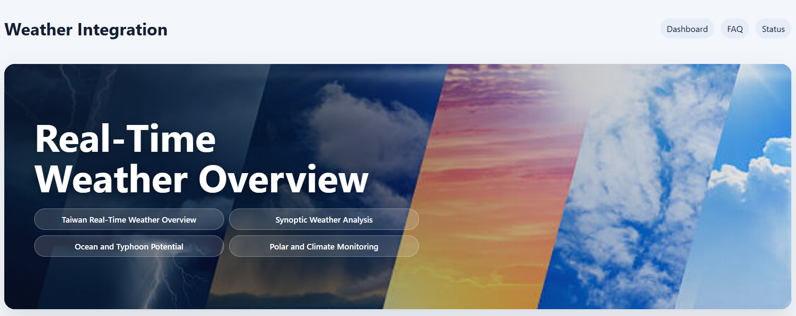
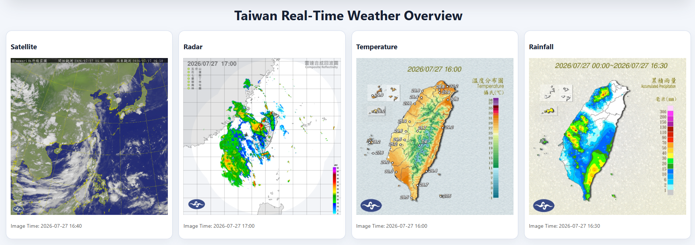
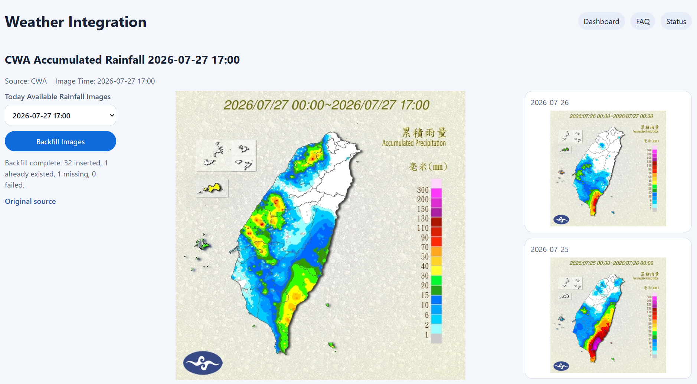
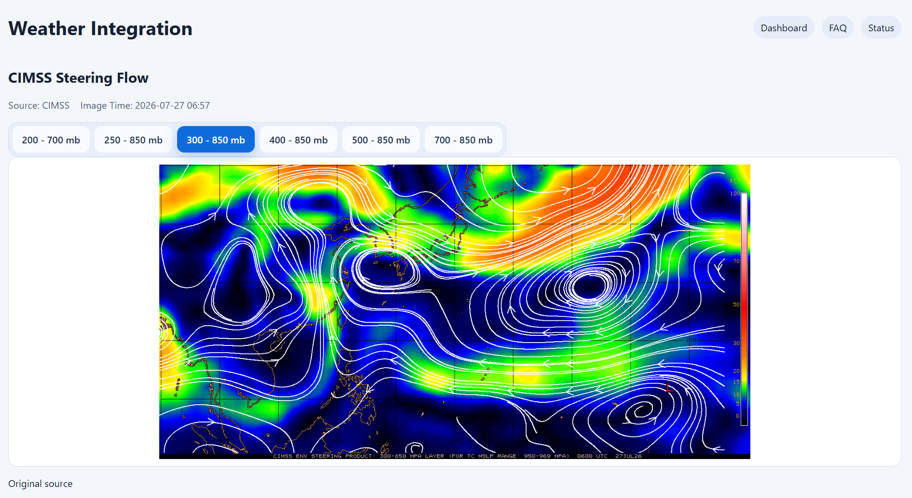
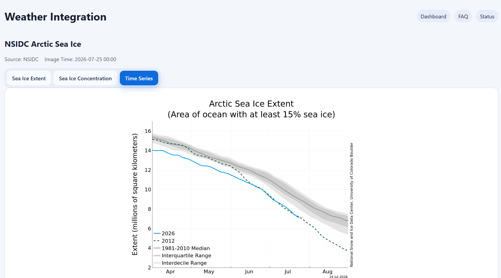
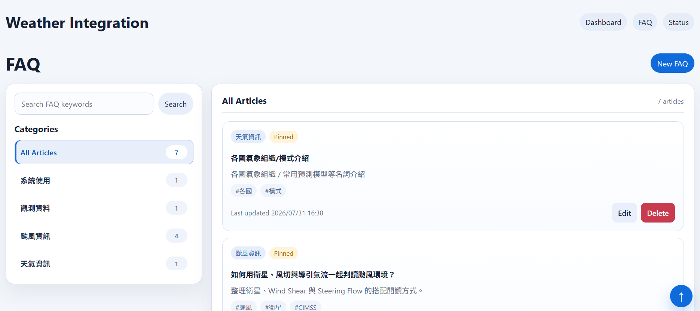
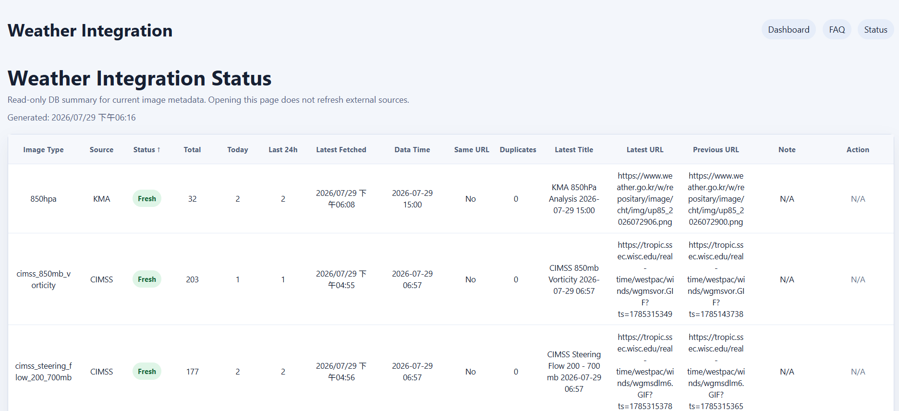

# Real-Time Weather Monitoring Website
## Overview
Real-Time Weather Monitoring Website is a local full-stack weather monitoring application built with React, Flask, and SQLite.
The application integrates public weather imagery and observational datasets from domestic and international meteorological organizations. It presents the collected information through a dashboard-style interface, allowing users to review multiple weather products efficiently in one place.

The project focuses on:
- Integrating weather products from multiple public sources
- Organizing weather imagery into categorized monitoring pages
- Managing image metadata and update status through a Flask backend
- Reducing unnecessary requests with duplicate prevention and time-to-live refresh rules
- Providing manual refresh and same-day backfill functions for selected datasets

## Technology Stack
- Frontend: React, Vite, HTML, CSS
- Backend: Python, Flask
- Database: SQLite
- Data Integration: Public APIs, image URL patterns, and source-specific data-fetching logic

## System Architecture
The React frontend requests weather data through Flask API endpoints.
The Flask backend retrieves public weather imagery or datasets from external sources, normalizes the relevant metadata, stores the records in SQLite, and returns the latest available results to the frontend.

```text
React Frontend
      |
      v
   Flask API
      |
      v
SQLite Metadata Database

Flask Backend
      |
      v
Public Weather Data Sources
```

The SQLite database stores image metadata rather than the image files themselves. Stored information may include the data type, title, source URL, observation time, fetch time, and creation time.

## Data Sources
The application currently integrates weather and climate products from:
- Central Weather Administration (CWA), Taiwan
- Japan Meteorological Agency (JMA), Japan
- Korea Meteorological Administration (KMA), South Korea
- Cooperative Institute for Meteorological Satellite Studies (CIMSS), University of Wisconsin-Madison
- National Snow and Ice Data Center (NSIDC), University of Colorado Boulder

All external images and datasets remain the property of their respective providers.

## Main Features
### Dashboard
The main dashboard organizes weather products into four monitoring categories.

#### Taiwan Real-Time Weather Overview

- CWA Satellite Imagery
- CWA Radar Imagery
- CWA Temperature Analysis
- CWA Rainfall Analysis

#### Synoptic Weather Analysis

- CWA Surface Weather Chart
- KMA 850 hPa Analysis

#### Ocean and Typhoon Potential

- CWA Tropical Cyclone Heat Potential
- JMA Sea Surface Temperature
- CIMSS Wind Analysis
- CIMSS Steering Flow
  
#### Polar and Climate Monitoring

- NSIDC Arctic Sea Ice
- NSIDC Antarctic Sea Ice

### Weather Product Pages
Each weather product is displayed on a dedicated page.
Depending on the data source, a page may contain:
- The latest available weather image
- Multiple related analysis images
- Observation and retrieval timestamps
- Source information
- Manual refresh controls
- Same-day backfill controls

The CIMSS pages display grouped wind-analysis and steering-flow imagery rather than a single image.
The NSIDC Arctic and Antarctic sea ice pages each provide separate views for sea ice extent, concentration, and time-series products.

### Data Refresh and Record Management
The backend includes several mechanisms for managing weather image records:
- Source-specific data-fetching logic
- SQLite-based image metadata storage
- Duplicate prevention for repeated records
- Time-to-live refresh rules for different data types
- Lazy fetching when a weather product is requested
- Manual refresh support for selected products
- Same-day backfill support for rainfall and radar imagery
- Retrieval of the latest available record for each data type

Refresh intervals vary according to the update frequency of each source. Frequently updated products such as satellite and radar imagery use shorter refresh periods, while climate and ocean products use longer refresh periods.

### FAQ Knowledge Base
The project includes an FAQ knowledge-management page for maintaining explanations and reference information related to the application and its weather products.

FAQ entries can include:
- A question or title
- Detailed explanatory content
- A category or tag
- Pinned status for important entries
- Create, edit, and delete operations

This page provides a centralized place to document data sources, product meanings, update behavior, known limitations, and operational notes.

### System Status Page
The system status page provides an overview of the availability and latest update status of supported weather products.
It can be used to:
- Review the latest available record for each product
- Check observation and retrieval times
- Identify delayed or unavailable sources
- Trigger manual refreshes for supported data types

## Backend API
The frontend communicates with the Flask backend through REST-style API endpoints.

### Image APIs
```http
GET /api/images/latest?type={image_type}
```

Returns the latest available image metadata for the requested weather product.
Additional API routes are used for source-specific refresh, rainfall observations, radar or rainfall backfill, FAQ management, and system status features.
For a complete endpoint list, refer to the Flask route definitions in the backend source code.

## Project Structure
```text
Weather_
├── backend
│   ├── app.py
│   ├── requirements.txt
│   ├── data
│   │   └── weather.db
│   ├── src
│   └── tests
├── frontend
│   ├── package.json
│   ├── public
│   └── src
└── README.md
```

The exact internal structure may change as pages, services, routes, and source-specific fetchers are separated into individual modules.

## Screenshots
Recommended screenshots for the repository:
1. Main dashboard

2. Taiwan real-time weather overview

3. Rainfall or radar page with manual refresh and backfill controls

4. CIMSS grouped analysis page

5. NSIDC sea ice page with tab navigation

6. FAQ knowledge base

7. System status page


## Running the Project Locally
### Prerequisites
Make sure the following software is installed:
- Python 3
- Node.js
- npm

### Clone the Repository
```bash
git clone <repository-url>
cd <repository-folder>
```
Replace `<repository-url>` with the GitHub repository URL and `<repository-folder>` with the directory created by `git clone`.


### Start the Backend
```powershell
cd backend
python -m venv .venv
.venv\Scripts\Activate.ps1
pip install -r requirements.txt
$env:CWA_API_KEY="your-cwa-api-key"
python app.py
```

The CWA API key is used only by the Flask backend when accessing CWA Open Data API endpoints that require authentication.
Do not place the API key in frontend environment variables, commit it to GitHub, or expose it through Vite variables.

Backend URL: `http://127.0.0.1:<backend-port>`
Replace `<backend-port>` with the port configured in `app.py`.

### Start the Frontend
Open another PowerShell terminal:
```powershell
cd frontend
npm install
npm run dev
```
Frontend URL: `http://127.0.0.1:5173`

When the frontend and backend use different ports, configure the frontend API base URL before starting Vite:

```powershell
$env:VITE_API_BASE_URL="http://127.0.0.1:<backend-port>"
npm run dev
```

## Configuration
The application may use the following environment variables:

| Variable | Location | Purpose |
| --- | --- | --- |
| `CWA_API_KEY` | Backend | Accesses supported CWA Open Data API endpoints |
| `VITE_API_BASE_URL` | Frontend | Defines the Flask backend base URL |

Environment variables containing API credentials should not be committed to the repository.
A `.env.example` file may be added to document required variables without exposing their actual values.

## Current Scope
This project is primarily designed as a locally operated personal weather-monitoring application.
It does not currently require:
- Continuous cloud deployment
- A permanent background scheduler
- User authentication
- Multi-user account management
- Image-file storage in the database

## Future Improvements
- Add scheduled background data updates
- Introduce a configurable data-retention and cleanup policy
- Expand structured API documentation
- Add a dedicated typhoon monitoring section
- Improve error reporting for unavailable external sources
- Add source-health and delayed-update indicators
- Add automated backend tests for additional data sources
- Provide deployment configuration for optional online hosting
- Add Docker-based local setup
- Improve accessibility and responsive layouts where needed

## Disclaimer
This project is intended for personal monitoring, software development practice, and weather-data integration.
The application is not an official forecasting or warning service. For weather warnings, emergency information, and operational decisions, always refer to official announcements issued by the relevant meteorological authorities.
